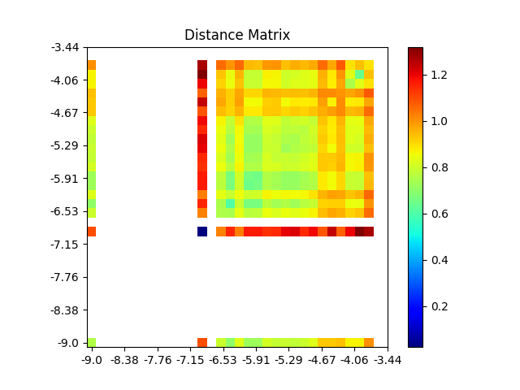

# Model representation visualization using similarity matrix

This tutorial will explain how to use the `plot_similarity_matrix` function within `imbal`, extending
the code from the [Balanced Fit with Validation](balanced_fit_val.md) tutorial.

All the source code in the tutorial can be found at `imbal/tutorials/SDO/regression/similarity_matrix.py`.

## Visualizing with t-SNE

First, we will use the code provided in the [Balanced Fit with Validation](balanced_fit_val.md) tutorial
to train a model on the SDOBenchmark dataset. Then, we can use
[imbal.regression.plot_similarity_matrix](../../../regression/plot_similarity_matrix.md)
function built into `imbal` to easily generate a similarity matrix plot for our model.

By default, `imbal` will use the second to last layer of a neural network as
the layer to visualize representations. This means that the predictions made by
the model are the result of a linear combination of relations shown in the
similarity matrix plot.

We add the following code at the end of the original tutorial code:

```python
imbal.regression.plot_similarity_matrix(
    model,
    x_test,
    y_test,
    bins=32,
    save_figure='similarity-matrix-visualization.png'
)
```
which results in the following plot:

<div style="display: flex; gap: 8px; max-width: 100%;">

</div>

This similarity matrix indicates that in general, the model is unable to achieve great results on the test
data. There is only a small region of labels that have low distance with other nearby labels, indicating that
in general, the model's representations are not tight for samples with the same label.