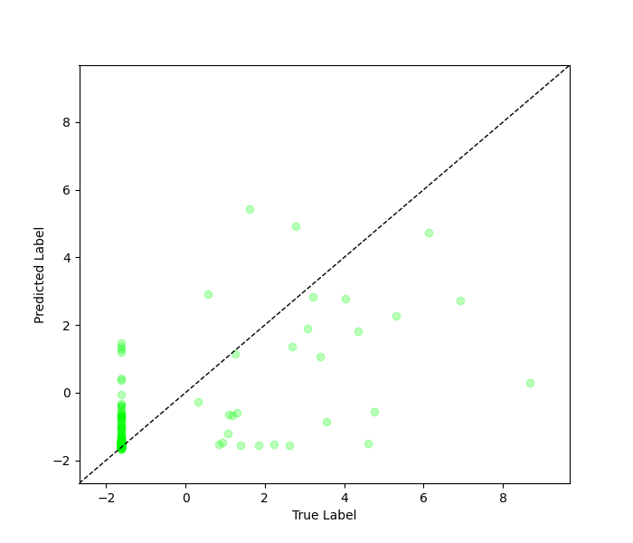

# Imbal Regression with Representation Loss

This tutorial walks through a complete machine learning workflow using a representation loss in Imbal for a regression task.

### Files Needed

**Full Code:** [view source code](../../../../../../tutorials/SEP-C/regression/imbal_tutorial_representation_loss.py)

**Train/Test Files**: [training data](../../../../../../tutorials/data/SEP-C/sep_model_training_regression.csv), [testing data](../../../../../../tutorials/data/SEP-C/sep_model_testing_regression.csv)

---

> **Before you begin:** Use the [Tutorial Setup](imbal_tutorial_setup_regression.md) guide as your starting point, then continue with this tutorial.

## 1. Representation Loss Definition

First, we define a simple representation loss that tries to ensure that the distance between
neighboring samples in the label space is the same as the distance between those samples'
representations.

In order to compute this loss, our samples must be sorted by label. We can leverage the
fact that Imbal's stratified batching produces batches that are in sorted order.

```python
import tensorflow as tf

def representation_loss_function(y_true, representations):
    label_distances = tf.abs(y_true[1:] - y_true[:-1])
    label_distances = tf.reshape(label_distances, [-1, 1])
    representation_distances = tf.norm(representations[1:] - representations[:-1], axis=1)
    representation_distances = tf.reshape(representation_distances, [-1, 1])
    return tf.reduce_mean(tf.square(representation_distances - label_distances))
```

## 2. Model Compilation and Training

### Compilation

We pass the defined representation loss to `imbal.regression.Model.compile`.

```python
model.compile(
    loss="mean_squared_error",
    optimizer="adam",
    metrics=["mae"],
    representation_loss=representation_loss_function
)
```

### Training

```python
max_epochs = 300
batch_size = 32

model.fit(
    x_train,
    y_train,
    batch_size=batch_size,
    epochs=max_epochs,
)
```

### Explanation

* **Loss**: Mean Squared Error (MSE), standard for regression.
* **Optimizer**: Adam for efficient gradient-based optimization.
* **Metric**: Mean Absolute Error (MAE) for interpretability.
* Uses standard `fit()` without imbalance handling.

---

## 3. Results

### Model Evaluation

```python
results = model.evaluate(x_test, y_test)
loss, mae = results
predictions = model.predict(x_test)

print(f"Test Loss: {loss:.4f}")
print(f"Test MAE: {mae:.4f}")

threshold = np.log(10)

y_true = y_test.reshape(-1)
y_pred = predictions.reshape(-1)

common_mask = y_true < threshold
rare_mask = y_true >= threshold

common_mae = np.mean(np.abs(y_true[common_mask] - y_pred[common_mask]))
rare_mae = np.mean(np.abs(y_true[rare_mask] - y_pred[rare_mask]))

print(f"Common sample MAE (< ln(10)): {common_mae:.4f}")
print(f"Rare sample MAE (>= ln(10)): {rare_mae:.4f}")
```

### Example Output

```text
Test Loss: 0.4844
Test MAE: 0.1915
Common sample MAE (< ln(10)): 0.1312
Rare sample MAE (>= ln(10)): 3.2132
```

---

## 4. Visualization

The model’s predictions are visualized by plotting true values against predicted values to assess performance and highlight rare vs. frequent samples.

```python
imbal.regression.plot_true_vs_predictions(
    y_test,
    predictions
)
```

### Example Output



---